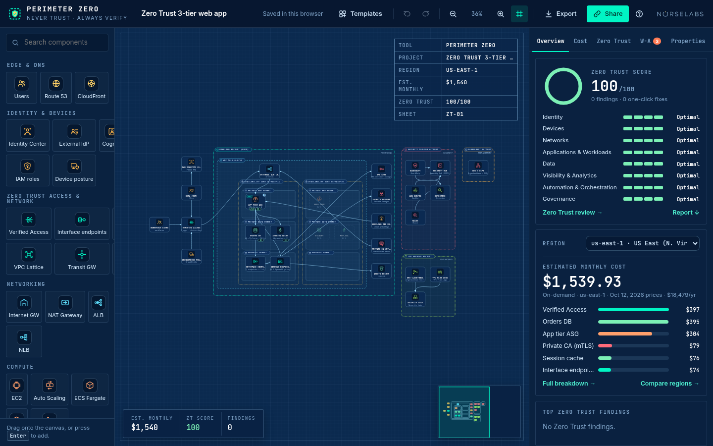
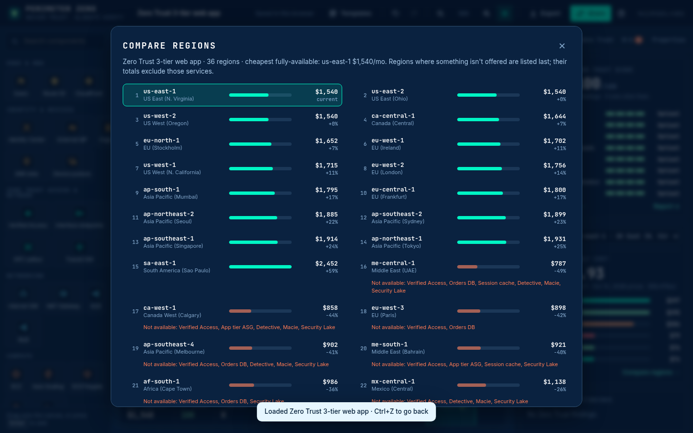
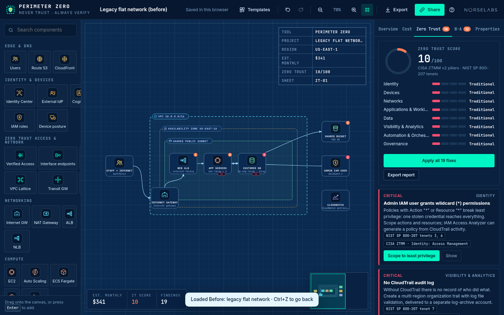

# Perimeter Zero

**Design Zero Trust AWS architectures, see how they score on the CISA Zero Trust Maturity Model, and what they cost in any of 36 regions, GovCloud included.**

Perimeter Zero is a browser-based architecture canvas for AWS with a Zero Trust focus. You drag services onto a blueprint, connect them, and get a live review. It rates the design on the CISA ZTMM v2 pillars, maps each finding to the NIST SP 800-207 tenets and offers one-click fixes. It also estimates monthly cost from published AWS prices. It runs at **[norselabs.net/zerotrust](https://norselabs.net/zerotrust/)** and as an offline macOS app.



---

## Contents
- [Features](#features)
- [Zero Trust model](#zero-trust-model)
- [Component catalog](#component-catalog)
- [Pricing](#pricing)
- [Getting started](#getting-started)
- [Using it](#using-it)
- [Keyboard shortcuts](#keyboard-shortcuts)
- [Building from source](#building-from-source)
- [Project structure](#project-structure)
- [Privacy](#privacy)
- [Disclaimer](#disclaimer)
- [License](#license)
- [Author](#author)

## Features
- **Blueprint canvas.** Drag and drop, connect services with arrows, snap to grid, pan and zoom, minimap, and grouping boxes for VPCs, AZs, subnets and AWS accounts.
- **50 component types.** All the Architect's Desk services plus identity, Zero Trust access, detection and governance services (see [Component catalog](#component-catalog)).
- **Zero Trust review.** Eight CISA ZTMM v2 rows, each with a maturity stage (Traditional, Initial, Advanced, Optimal), an overall 0–100 score, and findings with NIST SP 800-207 tenet references.
- **One-click fixes.** Each fix edits the diagram. **Apply all** fixes everything in one step, and a single undo reverts it.
- **Well-Architected review** as a secondary tab, with its own fixes.
- **Region-aware cost.** Estimates use AWS Price List snapshots for 36 regions, including both GovCloud regions. Services with no price in a region are marked **Not available** instead of being estimated.
- **Compare regions.** Prices the current design in every region, sorted cheapest first.
- **Templates.** Four Zero Trust templates, including a deliberately bad "Before" network, plus the six Architect's Desk templates.
- **Exports.** PNG, SVG, JSON, starter Terraform, and a Zero Trust report as Markdown or printable HTML.
- **Save, share, autosave.** JSON files, links that contain the diagram, and automatic local saving in the browser.
- **Overlays on nodes.** Security group scope and mTLS chips on compute and data nodes, and the auth type on VPC Lattice.
- **Phones.** Opens in a read-only review mode at narrow widths.

## Zero Trust model

### Pillars and cross-cutting functions
The review scores eight rows from the CISA Zero Trust Maturity Model v2.0:

| Pillars | Cross-cutting functions |
|---|---|
| Identity · Devices · Networks · Applications & Workloads · Data | Visibility & Analytics · Automation & Orchestration · Governance |

### Maturity stages and score
Each row moves up a ladder: **Traditional → Initial → Advanced → Optimal**. A stage only counts once the stage below it is met, and each stage depends on specific capabilities in the design. For example, Networks needs no flat network, public database or open SSH to reach Initial. To reach Advanced it needs private API paths, authenticated Lattice and HTTPS load balancers. Optimal also requires mTLS or Lattice for east-west traffic, inspected egress and gateway endpoints.

The stages are worth 10 / 40 / 70 / 100 points, and the overall score is the mean across the eight rows. For workforce users, the Devices row tracks device posture; for customer-only designs it tracks asset monitoring instead.

### NIST SP 800-207 mapping
Every finding cites the tenets it relates to from NIST SP 800-207 §2.1:

1. All data sources and computing services are considered resources.
2. All communication is secured regardless of network location.
3. Access to individual enterprise resources is granted on a per-session basis.
4. Access is determined by dynamic policy, including client identity, application/service and the requesting asset.
5. The enterprise monitors and measures the integrity and security posture of all owned and associated assets.
6. All resource authentication and authorization are dynamic and strictly enforced before access is allowed.
7. The enterprise collects as much information as possible about the current state of assets, network infrastructure and communications and uses it to improve its security posture.

### Review rules
Severities are Critical, High, Medium, Low and Note. Most rules come with a one-click fix.

| Pillar | Rule |
|---|---|
| Identity | No central workforce identity provider |
| Identity | Identity source or user pool doesn't require MFA |
| Identity | MFA isn't phishing-resistant |
| Identity | IAM role or policy grants wildcard (`*`) permissions |
| Identity | Relies on long-lived access keys |
| Devices | Device health isn't part of access decisions |
| Devices | Device posture is collected but not enforced |
| Devices | Intune isn't a native Verified Access device trust provider (note) |
| Networks | Flat network: tiers can reach each other freely |
| Networks | Database reachable from the internet |
| Networks | SSH open to 0.0.0.0/0 |
| Networks | AWS API calls leave through the NAT gateway (no interface endpoints) |
| Networks | S3 / DynamoDB traffic isn't on a private path (no gateway endpoints) |
| Networks | Outbound internet traffic isn't inspected |
| Networks | VPC Lattice service network accepts unauthenticated requests |
| Networks | Service-to-service calls are trusted by network location (no mTLS or Lattice auth) |
| Applications & Workloads | Internet path to the app without identity-aware access (Verified Access or Cognito) |
| Applications & Workloads | Workload roles aren't modeled |
| Data | Data at rest isn't encrypted everywhere |
| Data | Traffic isn't encrypted in transit everywhere |
| Data | S3 bucket can be made public |
| Data | No customer managed KMS keys |
| Data | Nobody is looking for sensitive data in S3 (no Macie) |
| Visibility & Analytics | No CloudTrail audit log |
| Visibility & Analytics | No VPC Flow Logs |
| Visibility & Analytics | No threat detection (GuardDuty) |
| Visibility & Analytics | Logs are collected but not correlated |
| Visibility & Analytics | CloudTrail has no log file validation |
| Visibility & Analytics | Verified Access decisions aren't logged |
| Automation & Orchestration | No continuous configuration monitoring (AWS Config) |
| Automation & Orchestration | No central security findings (Security Hub) |
| Automation & Orchestration | Misconfigurations are found but not fixed automatically |
| Governance | No organization-wide guardrails (SCPs) |
| Governance | Logs live in the same account as the workloads |
| Governance | Security tooling isn't in a delegated security account |
| Governance | CloudTrail isn't an organization trail |
| Governance | No conformance packs |
| Any | A service in the design isn't available (has no price) in the selected region |

Fixes take the region into account. Where VPC Lattice has no price, the east-west fix uses Private CA mTLS instead. For customer-facing apps, or where Verified Access has no price, the identity-aware access fix adds Cognito.

## Component catalog

| Category | Components |
|---|---|
| Edge & DNS | Users (Workforce / Customers), Route 53, CloudFront |
| Identity & devices | IAM Identity Center, External IdP (Okta / Entra), Cognito, IAM roles, Device posture (CrowdStrike / Jamf / JumpCloud / Intune) |
| Zero Trust access & network | Verified Access, Interface endpoints (PrivateLink), Gateway endpoints, VPC Lattice, Transit Gateway, Network Firewall |
| Networking | Internet Gateway, NAT Gateway, ALB, NLB |
| Compute | EC2, Auto Scaling, ECS Fargate, EKS, Lambda |
| Data & storage | S3, RDS, Aurora, DynamoDB, ElastiCache |
| Integration | API Gateway, SQS, SNS, EventBridge |
| Security & guardrails | WAF, KMS, Secrets Manager, Private CA, Macie, GuardDuty, Security Hub, Organizations |
| Detection & logging | CloudTrail, VPC Flow Logs, AWS Config, Detective, Security Lake |
| Operations | CloudWatch |
| Groups & accounts | VPC, AZ, Subnet, Account (workload / security / log archive / management) |

Several existing services have Zero Trust properties:
- **Security group scope** ("Tier SGs only" / "Whole VPC CIDR" / "0.0.0.0/0") on EC2, Auto Scaling, ECS, EKS, RDS, Aurora and ElastiCache.
- **mTLS** on EC2, Auto Scaling, ECS and EKS.
- **HTTPS** on ALBs, and **TLS required** on RDS and Aurora.

## Pricing
- **Source:** AWS Price List Bulk API regional CSV offer files (`pricing.us-east-1.amazonaws.com/offers/v1.0/aws/<service>/current/<region>/index.csv`), on-demand terms, first paid tier. The snapshots ship with the app as JSON in `src/data/regions/`. The base services were fetched **2026-10-12** and the Zero Trust services **2026-10-13**. The app does not fetch live prices.
- **Regions:** 36, including **us-gov-west-1** and **us-gov-east-1**.
- **Assumptions:** 730 hours per month and USD. Usage values such as GB processed, events, MAUs and certificates are properties on each component, and every cost line shows its calculation.
  - Cognito subtracts the 10,000 free MAUs.
  - The first copy of CloudTrail management events is free.
  - CloudFront and Route 53 are priced as global services.
- **Not priced:** IAM, IAM Identity Center, Organizations/SCPs, security groups and gateway endpoints have no AWS charge, so they add nothing. Third-party products (external IdP, device posture vendors) are licensed separately and aren't estimated.
- **Not available:** when a service has no price in the selected region, its line is marked **Not available**, it adds **$0** (there's no fallback to another region's price), and the review raises a region finding. For example, VPC Lattice and Macie have no GovCloud price in the snapshot. In Compare regions, regions with gaps are listed last and their totals leave those services out.



## Getting started

### Web
Open **https://norselabs.net/zerotrust/**. You don't need an account or an install. Editing works best on a desktop browser. On phones it opens in review mode.

### macOS app
The offline app is built with Electron and ships as two zips, one per architecture:

| File | Mac |
|---|---|
| `Perimeter-Zero-1.0.0-mac-arm64.zip` | Apple Silicon |
| `Perimeter-Zero-1.0.0-mac-x64.zip` | Intel |

It needs macOS 13 or later. Check the download with `shasum -a 256 -c SHA256SUMS.txt`.

The app is signed with a Developer ID certificate (Arnar DeMarco, 345B9QZN32) and notarized by Apple, with the ticket stapled, so it opens normally:

1. Unzip by double-clicking, or run `ditto -x -k Perimeter-Zero-1.0.0-mac-arm64.zip .`.
2. Drag **Perimeter Zero.app** to /Applications and open it.

To check the signature yourself: `spctl -a -vvv -t exec "/Applications/Perimeter Zero.app"` should report `accepted` and `source=Notarized Developer ID`.

## Using it
1. **Templates.** Press **T** or click **Templates**:
   - **Zero Trust:**
     - Zero Trust 3-tier web app
     - Zero Trust GovCloud workload (us-gov-west-1)
     - Zero Trust microservices (VPC Lattice)
     - **Before: legacy flat network**
   - **General:** 3-tier web app, Serverless API, Static site, Containerized microservices, Data pipeline, Blank canvas.
   - Template cards show their estimated monthly cost.
2. **Add and connect.** Drag a component from the palette onto the canvas, or focus it and press **Enter**. Drag from a node's port onto another node to connect them. Drop services inside VPC, AZ, subnet and account boxes to place them.
3. **Properties.** Select a node to edit its size, usage and security settings in the **Properties** tab. Cost and review update as you type.
4. **Review.**
   - The **Zero Trust** tab lists findings by severity with NIST and CISA references, the maturity ladder and the disclaimer.
   - Click a fix button to apply it, or **Show** to highlight the affected nodes.
   - **Apply all** fixes everything in one step, and **Ctrl/⌘ Z** undoes it.
   - The **W-A** tab holds the Well-Architected review.
5. **Region.** Pick a region in the Overview panel. **Compare regions** prices the design everywhere, and clicking a region switches to it.
6. **Export.** Use the **Export** menu:
   - **PNG / SVG:** the diagram with a branded footer.
   - **JSON:** the full diagram, which you can reopen later.
   - **Terraform:** a starter `.tf` for AWS provider v5.
     - It generates the VPC, subnets, gateways, route tables, load balancers, compute and data skeletons.
     - It also generates interface and gateway endpoints, Flow Logs (with log group and role), CloudTrail (with bucket and policy), GuardDuty, Security Hub with the AWS Foundational Security Best Practices standard, AWS Config (recorder, role, bucket, delivery channel), Macie, Detective, Private CA with an activated root certificate, Transit Gateway with a VPC attachment, a Lattice service network with its VPC association and auth policy, Cognito user pools, Verified Access (instance, trust providers, attachments, group) and a guardrail SCP.
     - It leaves **TODO** comments for anything it can't generate accurately: Network Firewall, Security Lake, IAM Identity Center, the external IdP, device posture, Verified Access endpoints, Lattice services, ALB mutual TLS, database TLS parameter groups, Config conformance packs and remediation, and the multi-account split.
     - It's a starting point, not production-ready.
   - **Zero Trust report:** Markdown, or printable HTML that you can save as PDF. It contains the region and estimated monthly cost, the Zero Trust score and the stage per pillar, every finding with its references, the components and the account each sits in, the Well-Architected review, the NIST tenets referenced, the method and the disclaimer.
7. **Save and share.**
   - **Save JSON / Open JSON** work with local files.
   - **Share** puts the compressed diagram in the link (`#d=…`) and copies it.
   - Work autosaves to the browser's localStorage.



## Keyboard shortcuts
These come from the app's key handler. **Ctrl** also means **⌘** on macOS.

| Keys | Action |
|---|---|
| Ctrl Z / Ctrl Shift Z (or Ctrl Y) | Undo / redo |
| Delete or Backspace | Delete selection |
| Ctrl D | Duplicate |
| Ctrl A | Select all |
| Arrow keys (Shift for bigger steps) | Nudge selection |
| Ctrl S / Ctrl O | Save / open JSON |
| Ctrl E | Export PNG |
| + / − | Zoom in / out |
| F / 0 | Fit to screen / reset zoom |
| G | Snap to grid on/off |
| T | Templates |
| ? | Help |
| Esc | Close dialog, clear selection |
| Enter (on a palette item) | Add it to the canvas |
| Drag empty space / Shift-drag | Pan / box-select |

The macOS app adds menu shortcuts:

| Menu | Item | Shortcut |
|---|---|---|
| File | New from Template | ⌘N |
| File | Open JSON | ⌘O |
| File | Save JSON | ⌘S |
| File | Export PNG | ⇧⌘P |
| File | Export SVG | ⇧⌘S |
| File | Export Terraform | ⇧⌘T |
| File | Export ZT Report (Markdown) | ⇧⌘R |
| File | Export ZT Report (HTML) | ⇧⌘H |
| Edit | Undo / Redo | ⌘Z / ⇧⌘Z |
| View | Zoom In / Zoom Out / Fit to Window | ⌘= / ⌘− / ⌘0 |
| Help | How Perimeter Zero Works | F1 |

## Building from source
**Web app.** There's no build step: plain HTML, CSS and JavaScript with no dependencies. Serve `src/` with any static server:
```sh
python3 -m http.server 8611 --directory src
# open http://localhost:8611/
```
Prices are fetched from `src/data/regions/*.json`, so open the app over HTTP rather than `file://`.

**Price data** (`pricing/`, Python 3, standard library only).
- `python3 pricing/extract_zt.py <region>` streams that region's AWS Price List CSV offer files from the public endpoint and writes the Zero Trust service prices to `pricing/zt/<region>.json`. Some offer files are hundreds of MB, so they're streamed, not stored. The intermediate `pricing/zt/` output isn't committed.
- `python3 pricing/make_regions_zt.py` merges those prices into `src/data/regions/*.json` in place, sets the "not available" flags, and writes `pricing/gaps.json`, which lists the services with no price per region.
- Re-fetching all regions:
  ```sh
  for r in $(python3 -c "import json;print(' '.join(x['code'] for x in json.load(open('src/data/regions/index.json'))['regions']))"); do
    python3 pricing/extract_zt.py "$r"
  done
  python3 pricing/make_regions_zt.py
  ```
- The base service prices (EC2, RDS, ALB and so on) in those files come from the Architect's Desk extractor, which isn't in this repo. Re-running these scripts only refreshes the Zero Trust services.

**macOS app** (`mac/`).
```sh
cd mac
npm ci                    # Electron + @electron/packager (pinned in package.json)
./fetch-rcodesign.sh      # once: downloads rcodesign 0.29.0 (checksum verified) into mac/tools/ (git-ignored)
./build.sh                # → mac/out/ (darwin arm64 + x64, linux x64) and mac/dist/*.zip + SHA256SUMS.txt
npm start                 # run the app locally from source (Electron)
```
- `mac/app/` holds the Electron main and preload scripts plus `web/`. `web/` is a copy of `src/` with desktop changes:
  - an app-origin CSP meta tag
  - `js/desktop.js`, which maps the native menu commands onto the app's buttons
  - share links that point at https://norselabs.net/zerotrust/
  - the wordmark linking out to norselabs.net
- After changing `src/`, copy it into `mac/app/web/` again and keep those changes.
- `build.sh` packages with `@electron/packager` and ad-hoc signs the macOS bundles with `rcodesign`. Set `RCODESIGN=/path/to/rcodesign` to use a different binary.
- It zips the apps with `zip -ry` (keeps framework symlinks).
- It runs on Linux. Without signing variables the macOS builds are ad-hoc signed only (not notarized).
- **Optional Developer ID signing and notarization** (`mac/sign-notarize.sh`, called by `build.sh` when `MAC_SIGN_KEY` is set). Nothing secret lives in the repo; the variables point at files you keep elsewhere:
  ```sh
  # MAC_SIGN_KEY: PEM private key of your "Developer ID Application" certificate; MAC_SIGN_CERT: that certificate (DER)
  # MAC_NOTARY_API_KEY (optional): App Store Connect API key JSON from `rcodesign encode-app-store-connect-api-key`
  MAC_SIGN_KEY=~/secrets/devid.key MAC_SIGN_CERT=~/secrets/devid.cer MAC_NOTARY_API_KEY=~/secrets/asc.json \
  ./build.sh
  ```
  It signs with the hardened runtime, a secure timestamp and `mac/build/entitlements.plist` (JIT, unsigned executable memory, disabled library validation, as Electron needs), nested frameworks and helpers included, then submits, waits for and staples the notarization. Signing needs to reach `http://timestamp.apple.com`.
- **On a Mac with Xcode Command Line Tools** you can do the same with Apple's tools instead. With the identity in your keychain and a notary profile from `xcrun notarytool store-credentials <profile> --key AuthKey_XXXX.p8 --key-id <id> --issuer <issuer>`:
  ```sh
  APP="out/Perimeter Zero-darwin-arm64/Perimeter Zero.app"; ID="Developer ID Application: Your Name (TEAMID)"; ENT=build/entitlements.plist
  cs() { codesign --force --timestamp --options runtime --entitlements "$ENT" -s "$ID" "$1"; }
  # inside out: loose Mach-O files, then frameworks, then helper apps, then the app
  find "$APP/Contents/Frameworks" -type f ! -path "*.app/Contents/MacOS/*" -print0 | while IFS= read -r -d '' f; do file -b "$f" | grep -q Mach-O && cs "$f"; done
  for f in "$APP"/Contents/Frameworks/*.framework "$APP"/Contents/Frameworks/*.app "$APP"; do cs "$f"; done
  codesign --verify --deep --strict --verbose=2 "$APP"
  ditto -c -k --keepParent "$APP" notarize.zip
  xcrun notarytool submit notarize.zip --keychain-profile <profile> --wait
  xcrun stapler staple "$APP" && spctl -a -vvv -t exec "$APP"
  ditto -c -k --keepParent "$APP" Perimeter-Zero-1.0.0-mac-arm64.zip
  ```

**Tests** (`tests/`, Playwright, using a local Chrome or Chromium).
```sh
cd tests && npm ci
npm run serve &                         # serves ../src on http://localhost:8611/
npm run test:web                        # web app at 1440 and 390 px, 0 console errors required
npm run test:electron                   # Electron Linux build (run mac/build.sh first; needs xvfb-run)
npm run tf:generate                     # writes tests/output/tf/<template>/main.tf for every template
```
- `tests/web.test.js` covers templates, drag and drop, connecting, properties, every Zero Trust rule with its fix and undo, Apply all, region pricing including GovCloud, exports, share, autosave and mobile.
- `tests/electron.test.js` covers offline loading, the security settings, every native menu item, GovCloud repricing, Apply all and window-state persistence.
- To validate the generated Terraform, run `terraform init -backend=false && terraform validate` in each output folder.
- Settings come from environment variables:
  - `PZ_BASE`: the URL under test, for example https://norselabs.net/zerotrust/
  - `CHROME_PATH`: the Chrome or Chromium binary
  - `PZ_ELECTRON`: the Electron executable
  - `PZ_OUT`: where screenshots and exports go
- Output goes to `tests/output/` (git-ignored).

## Project structure
```
src/                    the web app (what is deployed)
  index.html
  css/                  base.css (layout, components), theme.css (Blueprint theme, teal accent)
  js/
    catalog.js          component types, properties, icons
    cost.js             cost lines from regional price data
    analysis.js         Well-Architected review
    templates.js        general templates
    terraform.js        starter Terraform generator
    zt.js               Zero Trust components, region-aware costs, ZT review, report, ZT templates
    zt-terraform.js     Terraform for the Zero Trust components
    app.js              canvas, panels, undo/redo, save/share/export
  data/regions/         36 regional price snapshots + index.json
  fonts/                Inter and JetBrains Mono (OFL)
pricing/                price extraction and merge scripts, gaps.json (regional availability gaps)
mac/                    Electron app: app/ (main.js, preload.js, web/), build/ (icon), build.sh, fetch-rcodesign.sh, package.json
tests/                  Playwright tests (web, Electron) and the Terraform generator
docs/images/            README screenshots
```

## Privacy
- **No accounts, cookies, analytics or telemetry.** The only network requests the web app makes are for its own files on the same origin, including the regional price JSON. The source contains no third-party scripts or tracking code.
- **Your diagrams stay on your device.** They're stored in your browser's localStorage. Share links carry the diagram in the URL fragment (`#d=…`), which browsers don't send to the server.
- **The macOS app is fully offline.** All assets, fonts and price data are bundled and served from an internal `app://` origin. The app blocks every outgoing http(s) and WebSocket request. External links (the Norselabs wordmark, Help menu links) open in your default browser.
- **macOS app security settings:** context isolation on, Node integration off, sandboxed renderer, Content Security Policy, and navigation and new windows locked down.

## Disclaimer
Perimeter Zero produces an automated review of a **diagram**. Its findings are **aligned with** the CISA Zero Trust Maturity Model v2.0 and NIST SP 800-207. It is **not** an assessment of a deployed system, and it doesn't make any system compliant with, certified against, or authorized under any framework. Cost figures are estimates from published on-demand list prices and the usage assumptions shown. They exclude taxes, discounts, free tiers (except where noted), Savings Plans and third-party licenses. Generated Terraform is a starting point and must be reviewed before use.

Perimeter Zero is an independent project. It is not affiliated with, endorsed by, or sponsored by Amazon Web Services, CISA or NIST. AWS, Amazon Web Services and the names of AWS services are trademarks of Amazon.com, Inc. or its affiliates. Okta, Microsoft Entra, Microsoft Intune, CrowdStrike, Jamf, JumpCloud, Terraform and other names are trademarks of their respective owners.

## License
Released under the [MIT License](LICENSE).

## Author
**Arnar DeMarco** · Norselabs · [norselabs.net](https://norselabs.net)
